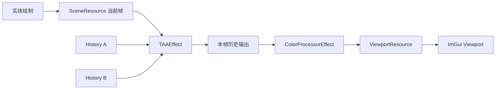

# 教学版 TAA 实现说明

## 目标

当前工程新增了一条可以直接观察的时间抗锯齿学习通路。Viewport 面板的 `TAA` 开关打开后，场景颜色会先经过 `TAAEffect`，再交给原有的 `ColorProcessorEffect` 显示到 `ViewportResource`。

## 渲染顺序



`TAAEffect` 内部持有两张尺寸跟随视口的 `EffectResource`。每帧选择一张作为历史输入，另一张作为渲染输出，绘制完成后交换索引。这样当前帧和历史帧不会同时把同一张纹理绑定为 SRV 与 RTV，避免 D3D11 资源绑定冲突。

首帧没有有效历史，Shader 直接返回当前颜色。开启、关闭后重新开启、视口尺寸改变以及 Lit/World Normal 调试视图切换都会让历史重新从当前帧开始。

## Shader 算法

`TAAEffectPS.hlsl` 先对当前像素周围 3x3 邻域采样，计算当前帧颜色的最小值和最大值，再把历史颜色限制在这个范围内，最后按 `C_TAAParameters.x` 混合：

```text
当前颜色 = CurrentSceneTexture
历史颜色 = clamp(HistoryTexture, 当前帧 3x3 邻域最小值, 当前帧 3x3 邻域最大值)
输出颜色 = lerp(当前颜色, 历史颜色, 历史权重)
```

当前历史权重为 0.10，意味着当前帧占 90%，历史帧占 10%。较小的历史权重适合先观察稳定性，也能降低测试模型运动时的拖影。

## 测试模型

`ViewManager::CreateTAATestEntities()` 创建独立的 `TAA Test Rods` Model：五根不同深度、颜色和旋转角度的细长立方体，以及两根横向细线。细边缘、不同深度和交叉线条可以在低分辨率或相机轻微移动时显示锯齿闪烁、历史稳定性和拖影。

## 当前边界

这是一条用于学习资源管理、全屏 Pass 和历史累积的教学实现。它还没有子像素投影抖动、运动矢量、深度重投影和反遮挡判断，因此相机快速移动或物体发生位移时会出现拖影。下一步可以把 Halton 序列抖动加入 `EffectFrameContext` 的投影矩阵，并增加 Motion Vector Render Target，再按速度和深度重投影历史像素。
